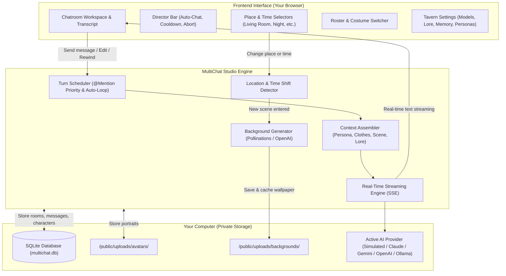

# MultiChat Studio

> **Interactive Multi-Character AI Storytelling & Roleplay Studio for Your Computer**  
> Run lively group roleplay where multiple AI characters talk to you and to each other in shared scenes, complete with changing locations, time of day, AI-generated backgrounds, and wardrobe changes.  
> *100% private, runs on your machine, with zero-setup free offline mode or your favorite AI providers (OpenAI, Claude, Gemini, Ollama, OpenRouter, LM Studio).*

---

## 🧭 What is MultiChat Studio?

Imagine a visual novel or tabletop RPG where:
* You can put **multiple AI characters in the same room**. They respond to what you say and naturally banter, argue, or collaborate with each other.
* You can **travel to different places and times** (e.g., from *Home: Living Room* in the morning to *Tokyo: Neon Alley* at midnight).
* The **chat background changes dynamically** with visual novel-style art generated for each location and time of day.
* Characters can **change outfits mid-story**, and other characters will notice what they are wearing.
* You are the **story director**: you can pause, edit messages, step turns one-by-one, let auto-chat run, or mention specific characters (`@Name`).
* **Runs completely free out of the box** using the built-in Local Simulated Engine, or connects to Claude, Gemini, OpenAI, or local Ollama with one click.

---

## 🌟 Key Features

```
┌─────────────────────────────────────────────────────────────────────────────┐
│                             MultiChat Studio                                │
├──────────────────────┬────────────────────────────┬─────────────────────────┤
│  🎭 Multi-Character  │  🌄 Dynamic Places & Time  │  👗 Wardrobe & Outfits  │
│  Group chats where   │  Move between rooms & times│  Change character       │
│  AI characters talk  │  with auto-generated anime │  costumes mid-chat with │
│  to you & each other │  background wallpapers.    │  visual portraits.      │
├──────────────────────┼────────────────────────────┼─────────────────────────┤
│  🧠 Smart AI Gateway │  🎬 Director Controls      │  🔒 100% Private        │
│  Free built-in engine│  Auto-chat, cooldowns,     │  All chats, characters, │
│  + OpenAI, Claude,   │  @mentions, rewinds, and   │  and images stay safely │
│  Gemini & Ollama.    │  in-line message editing.  │  on your hard drive.    │
└──────────────────────┴────────────────────────────┴─────────────────────────┘
```

### 1. 🎭 Multi-Character Group Conversations
* **True Multi-Agent Chat**: Put 2, 3, or more characters together. Characters talk directly to you and each other in natural dialogue.
* **Smart Perspective Separation**: Each character only sees the story through their own eyes and personality—they never accidentally speak for you or write from another character's point of view.

### 2. 🌄 Places, Sub-Places & Dynamic Time of Day
* **Organized Locations**: Group locations into Main Places and Sub-Places:
  * *Example:* **Home** ➔ *Living Room*, *Kitchen*, *Bedroom*, *Balcony*.
  * *Example:* **Sci-Fi Starship** ➔ *Bridge*, *Engine Room*, *Mess Hall*.
* **6 Time-of-Day Slots**: Switch between `Dawn`, `Morning`, `Noon`, `Sunset`, `Night`, and `Midnight`, or type custom times (e.g. *"2:15 AM, Heavy Rain"*).
* **Two Ways to Travel**:
  1. **Quick Dropdowns**: Change the Place, Sub-Place, or Time instantly from the top bar.
  2. **Natural Story Narration**: Write actions like *"We walked to the kitchen at night"* or *"Let's head to the park at sunset"*—the engine automatically detects location and time shifts in your story!

### 3. 🎨 Dynamic Visual Novel Backgrounds
* **Automatic Scenic Art**: When you move to a new location or change the time of day, the studio can automatically generate high-quality anime-style background art.
* **Cached Once Per Scene**: Backgrounds generate only once per location and time of day, keeping generation fast and saving costs.
* **Custom Image Upload**: Prefer your own photo or wallpaper? You can upload custom background images for any sub-place and time slot with one click.
* **Safe Cleanup**: When you delete a chatroom, all cached background files for that room are automatically cleaned up from your disk.

### 4. 👗 Character Wardrobe & Outfits
* **Permanent Traits vs. Clothing**: Define permanent physical features (hair, eyes, height, build) separately from temporary clothes.
* **Multiple Costumes**: Give any character alternate outfits (e.g., *Casual Pajamas*, *School Uniform*, *Battle Armor*, *Formal Dress*), each with its own clothing description and dedicated portrait.
* **Mid-Chat Costume Changes**: Change a character's outfit during conversation via the right sidebar. Their portrait updates immediately, and everyone in the room will react to what they are wearing!

### 5. 🎬 Director Controls & Auto-Chat
* **Auto-Chat Mode**: Sit back and watch the conversation unfold automatically with customizable turn pacing.
* **Cooldown Buffer**: A visible countdown bar lets you read responses comfortably before the next character speaks, with **Skip Cooldown** and **Pause / Abort** buttons.
* **`@character` Mentions**: Type `@` to select who should speak next. Characters can also mention each other in dialogue, naturally passing the conversation floor!
* **Quick Responses**: Click the magic wand button to generate 3 smart reply suggestions written in your character's voice. Click any option to send or tweak it.

### 6. ✍️ Full Story Interventions (Edit, Regenerate, Rewind)
* **In-Line Message Editing**: Click the pencil icon on any past message to fix a typo or steer the plot. All future AI turns adapt to your edit immediately.
* **Versioned Regenerations**: Don't like a character's reply? Click **Regenerate** to roll an alternate response (`v1/3`, `v2/3`, `v3/3`) and flip between them anytime.
* **Rewind & Branch**: Rewind history to any point, trimming subsequent messages to branch your story in an exciting new direction.

### 7. 🔌 Flexible AI Models & Providers
* **Local Simulated Roleplay Engine (Built-In & Free)**: Works 100% offline with zero setup and zero API keys needed. Perfect for immediate testing and private fun without cost.
* **Dedicated Cloud & Local Presets**:
  * **OpenAI** (`https://api.openai.com/v1`) — GPT-4o, GPT-4o-mini
  * **Claude (Anthropic)** (`https://api.anthropic.com/v1`) — Claude 3.5 Sonnet, Claude 3.5 Haiku
  * **Google Gemini** (`https://generativelanguage.googleapis.com/v1beta/openai`) — Gemini 2.0 Flash, Gemini 1.5 Pro
  * **OpenRouter** (`https://openrouter.ai/api/v1`) — Access hundreds of open & commercial models
  * **Ollama (Local & Free)** (`http://localhost:11434/v1`) — Llama 3.2, Qwen 2.5, DeepSeek, Mistral
  * **LM Studio (Local & Free)** (`http://localhost:1234/v1`) — Any local `.gguf` weights
  * **Custom OpenAI-Compatible** — Connect any private server (Groq, Together AI, vLLM, KoboldCPP)
* **Honest Model Lists**: If no API key is entered, no phantom remote models are shown. You are always in control of your connections.

### 8. 🏰 Moescape / Tavern Storytelling Settings
* **User Personas**: Create multiple personas for yourself (name, bio, avatar) so characters address you accurately.
* **World Lorebooks**: Add world lore entries that inject into the AI's mind only when relevant keywords are mentioned.
* **System Prompt Presets**: Switch between writing styles (*Roleplay*, *Spicy*, *Novelistic*, *Short Dialogue*).
* **Story Memory & Auto-Summaries**: Keep a persistent memory box, or click **Summarize Room** to let the AI condense hundreds of messages into key memory bullet points.

---

## 🏛️ How It Works (System Architecture)



---

## 💻 System Requirements

* **Operating System**: Windows, macOS, or Linux.
* **Node.js**: `v22.0.0` or newer (Node 22 or 26 recommended; uses Node's built-in fast SQLite engine).
* **Package Manager**: `npm`, `pnpm`, or `yarn`.
* **AI Provider Options**:
  * **Completely Free (Zero Setup)**: Built-in Local Simulated Engine.
  * **Completely Free (Offline Local AI)**: [Ollama](https://ollama.com/) or [LM Studio](https://lmstudio.ai/).
  * **Cloud APIs**: API key from Google AI Studio, Anthropic, OpenAI, or OpenRouter.

---

## 🚀 Quick Start Tutorial

### Step 1: Download the Project
```bash
git clone https://github.com/your-username/MultiChatStory.git
cd MultiChatStory
```

### Step 2: Install Dependencies
```bash
npm install
```

### Step 3: Start the Studio
```bash
npm run dev
```

### Step 4: Open in Your Browser
Open your browser and go to:
👉 **[http://localhost:3000](http://localhost:3000)**

*(The SQLite database `multichat.db` initializes and seeds default roleplay characters automatically on first launch!)*

---

## 📖 Step-by-Step User Guide

### 1. Creating or Editing Characters
1. Click **Character Database** in the left sidebar.
2. Click **Create New Character** (or click an existing character card to edit).
3. **Persona Tab**:
   * Enter their name and role (e.g., *"Evelyn, Starship Chief Engineer"*).
   * Upload an avatar portrait and pick a signature border color.
   * Write their permanent physical traits (hair, eyes, body build).
   * Describe their personality, quirks, and speaking cadence.
4. **Wardrobe & Outfits Tab**:
   * Click **+ Add Outfit** to give them alternate costumes (e.g., *Uniform*, *Casual*, *Armor*).
   * Describe what they are wearing and optionally upload a matching portrait for each outfit.
5. Click **Save Character**.

### 2. Creating a Multi-Character Chatroom
1. Click **New Multi-AI Chatroom** in the left navigation.
2. Give your story a **Title** (e.g., *"Late Night Shift at the Station"*).
3. Set the initial **Scenario Prompt** (e.g., *"A thunderstorm has knocked out power to the estate. We are gathered in the library."*).
4. Select 2 or more characters from your library to join the room.
5. Arrange their initial turn order and click **Create Chatroom**.

### 3. Exploring Places & Time of Day
1. Look at the top bar above the messages. You will see:
   * **Place:** (e.g., *Grand Estate*)
   * **Sub-Place:** (e.g., *Library*, *Kitchen*, *Garden*)
   * **Time:** (e.g., *Night*, *Sunset*, *Morning*)
2. Switch to any Sub-Place or Time:
   * The story scene updates.
   * If auto-generate backgrounds is enabled, an anime-style visual novel background matching your scene appears automatically!
   * Click the **Photo/Upload** icon to assign your own custom wallpaper image anytime.
3. You can also change scenes naturally just by typing:
   * *"We left the living room and walked out to the balcony under the midnight stars."*
   * The studio detects the change and switches the environment automatically!

### 4. Directing the Story
* **Type a Message**: Talk to everyone, or type `@CharacterName` to address someone specifically.
* **Trigger a Turn**: In the right sidebar, click **Trigger [Name] to Speak** anytime you want a specific character to chime in.
* **Auto-Chat**: Click **Start Auto-Chat** in the top bar to let characters converse back and forth on their own.
* **Quick Responses**: Click the magic wand icon above the text box to view 3 suggested replies written for your persona.
* **Fixing Mistakes**: Hover over any message and click **Edit** (pencil), **Regenerate**, or **Rewind Here**.

### 5. Configuring AI Models & Settings
Click **Tavern Chat Settings** at the bottom of the left sidebar:
* **Model & Provider**: Choose your provider (Google Gemini, Anthropic Claude, OpenAI, Ollama, OpenRouter, or Local Simulated). Enter your API key and click **Fetch Models**.
* **Places & Time**: Add new places, create sub-places, customize descriptions, or clear cached backgrounds.
* **Personas**: Edit how characters see you (your name, avatar, and background story).
* **Memory & Lore**: Read the memory box or click **Summarize Room** to compress old messages into permanent story memories.

---

## 🔒 Privacy & Data Safety

* **100% Localhost**: MultiChat Studio runs locally on your machine.
* **Your Data Stays Yours**: Your chat history, character descriptions, and pictures are never sent to external tracking servers.
* **Git-Safe**: All personal data files are excluded by `.gitignore`:
  * `multichat.db*` (SQLite databases and message histories)
  * `public/uploads/*` (Character avatars and generated backgrounds)
  * `.env*.local` (Your personal API keys)
* **Clean Deletions**: Deleting a chatroom permanently wipes its messages, version branches, and cached background images from disk.

---

## 📜 License

MIT License. Built with passion for interactive AI storytelling, tabletop roleplay, and creative writing. Feel free to customize and expand!