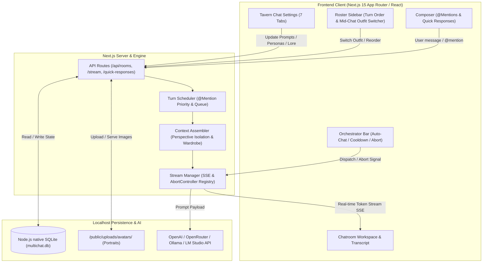
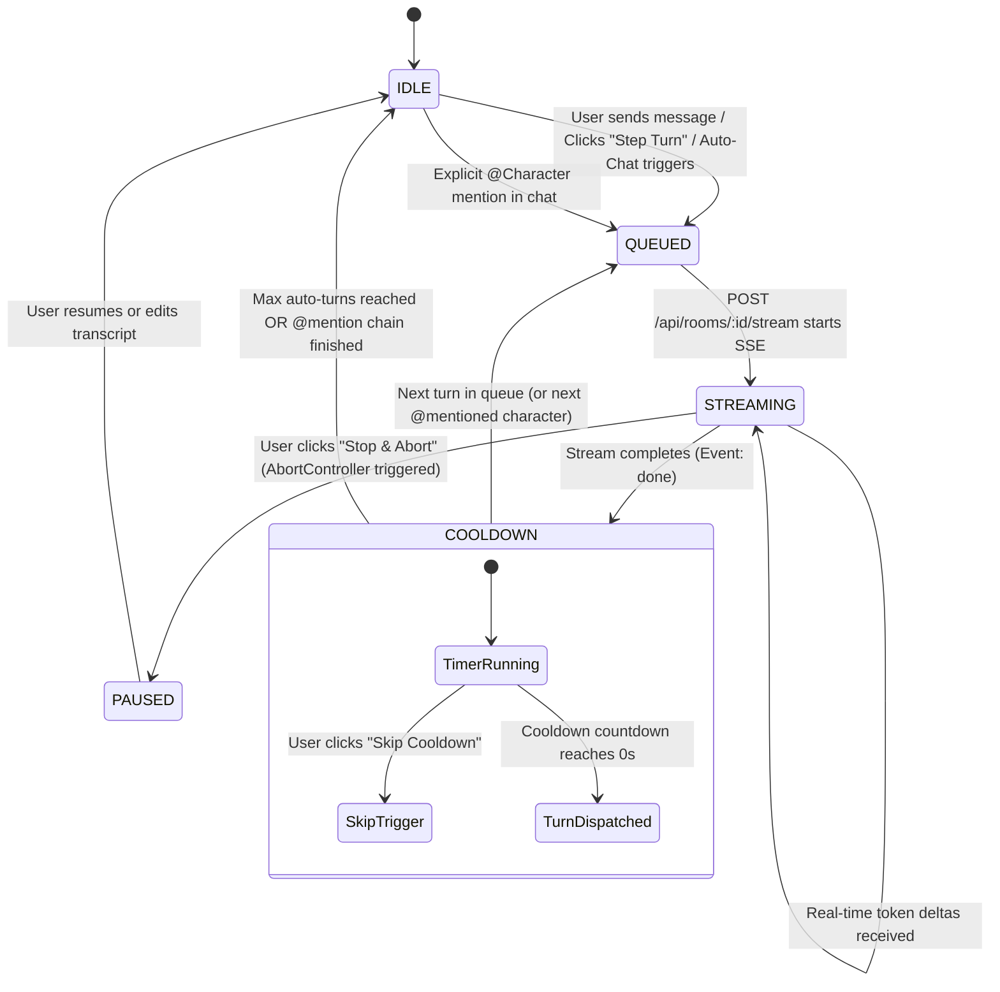
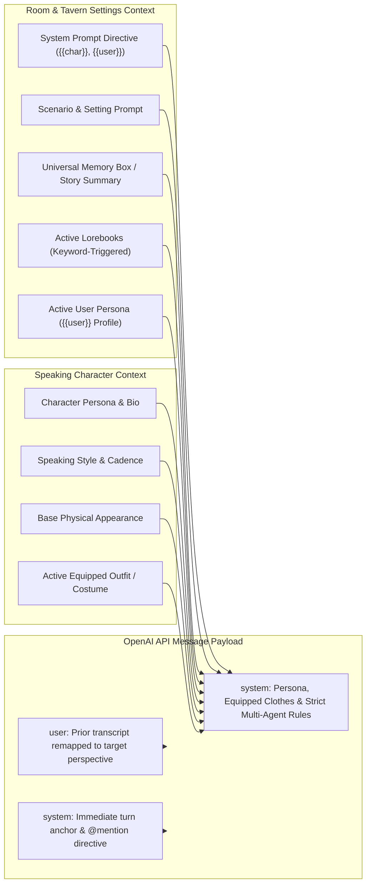

# MultiChat Studio

> **Localhost Multi-Character AI Chatroom & Persona Orchestration Engine**  
> Built with Next.js 15 (App Router), Node.js native `node:sqlite` (WAL Mode), OpenAI-compatible SSE Streaming, and Moescape/Tavern-style story controls.

---

## 🏛️ System Architecture



---

## 🌟 Key Features

### 1. Multi-Character AI Chatrooms
* **Multi-Agent Conversations**: Assign two or more AI characters to a room. Characters talk to the human user and interact dynamically with each other in the same shared scene.
* **Speaker Isolation & Perspective Assembly**: Each character prompt is assembled with strict perspective separation—the model is given only its own persona instructions, while prior dialogue from other characters and the user is clearly attributed in transcripts.

### 2. Autonomous Turn-Taking & Orchestration Engine
* **Flexible Turn Strategies**:
  * **Round-Robin**: Sequentially passes turns through the room roster.
  * **Dynamic Relevance Router**: Evaluates who was addressed or most relevant to the latest turn.
  * **Manual Trigger Only**: The director decides exactly who speaks and when.
* **Countdown Buffer & Cooldown**: Visual countdown buffer before each turn dispatch, giving you time to read, pause, or intervene.
* **Configurable Loop Cap**: Set maximum consecutive auto-turns (e.g., 8 turns) to prevent runaway token usage.
* **Real-Time Stream Interruption**: Instant **Pause**, **Resume**, and **Stop & Abort** buttons leveraging native `AbortController` over Server-Sent Events (SSE).



### 3. `@character` Mention System
* **Targeted Invocation**: Type `@` or click a character's mention pill (e.g., `@Sarah Chen` or `@Elria`) to trigger **only** that character to speak.
* **AI-to-AI Handoffs**: Characters recognize each other's `@mentions`. If an AI character mentions another cast member in dialogue, the turn engine automatically passes the floor to that character next.
* **Interactive Autocomplete**: Live popup suggestions when typing `@` in the chat composer.

### 4. "Quick Responses" (3x User Reply Suggestions)
* **Context-Aware Suggestions**: Click the **Quick Responses** wand to generate 3 natural, in-character user responses from your active Persona (`{{user}}`).
* **Click to Edit**: Click any suggested response to load it into the message input box for fine-tuning before sending.
* **One-Click Regenerate**: Regenerate 3 fresh options anytime.

### 5. Character Wardrobe & Multi-Outfit System
* **Base Physical Traits**: Separate permanent traits (hair, eyes, height, body build) from temporary clothing.
* **Multiple Outfits per Character**: Add unlimited costumes with custom outfit names, clothing descriptions, behavior/mood notes, and optional dedicated portraits.
* **Mid-Chat Outfit Switcher**: Change a character's outfit mid-story in the right-hand sidebar. Their avatar and prompt identity update immediately, and other characters in the room will notice what they are wearing!

### 6. Unified Tavern Chat Settings (Moescape-Style)
* **Model & Sampler Tuning**: Real-time sampler sliders (Temperature, Response Tokens, Top-P, Top-K, Min-P, Repetition Penalty, Frequency/Presence Penalty).
* **Provider Presets**: 1-click connection presets for **OpenAI**, **OpenRouter**, **Ollama (Local)**, and **LM Studio (Local)**.
* **System Prompt Presets**: Manage global writing directives (`Roleplay`, `Spicy Roleplay`, `Default`, `Long Responses`, `Sol Narrator`) with `{{char}}` and `{{user}}` macro support.
* **User Personas**: Describe yourself to characters with custom display names, bios, and portraits.
* **Shared Memory & Auto-Summary**: Universal room memory box with an **Auto-Summarize** tool that condenses the transcript into key facts.
* **Lorebooks (World Info)**: Create lore entries with keyword triggers that inject into LLM context when mentioned in conversation.

### 7. Human-in-the-Loop Interventions
* **Inline Message Editing**: Edit any prior user or character response directly in the transcript; subsequent AI turns immediately feed on the edited text.
* **Multi-Version Regeneration**: Regenerate any character response in-place with version tracking (`v1/3`, `v2/3`, `v3/3`).
* **Rewind & Branch**: Rewind history to any point, trimming subsequent messages to branch off into a new narrative direction.
* **Safe Deletions**: Individual message deletion and room deletion with safety confirmation dialogs.

### 8. 100% Localhost & Privacy First
* Powered by Node's built-in `node:sqlite` in WAL mode—no external database servers required.
* Uploaded character portraits and avatars are saved locally to `/public/uploads/avatars/`.
* SQLite databases, local portraits, and API keys are ignored by `.gitignore`.

---

## 💻 System Requirements

* **Node.js**: `v22.0.0` or newer (Recommended: Node 22 or Node 26 with built-in `node:sqlite`).
* **Package Manager**: `npm`, `pnpm`, or `yarn`.
* **LLM Provider Options**:
  * **Zero-Key / Free Built-in Engine**: Built-in **Local Simulated Roleplay Engine** (100% free, offline, instant responses with zero external keys or setup).
  * **Cloud APIs**: Official OpenAI (`https://api.openai.com/v1`), Anthropic Claude Messages API (`https://api.anthropic.com/v1`), Google Gemini AI Studio (`https://generativelanguage.googleapis.com/v1beta/openai`), OpenRouter gateway (`https://openrouter.ai/api/v1`), or any Custom OpenAI-Compatible endpoint (DeepSeek, Groq, Together, vLLM).
  * **Local Offline Inference**: [Ollama](https://ollama.com/) (`http://localhost:11434/v1`) or [LM Studio](https://lmstudio.ai/) (`http://localhost:1234/v1`).

---

## 🚀 Installation & Setup Tutorial

### Step 1: Clone the Repository
```bash
git clone https://github.com/your-username/MultiChatStory.git
cd MultiChatStory
```

### Step 2: Install Dependencies
```bash
npm install
```

### Step 3: Configure Environment (Optional)
Copy the example environment file:
```bash
cp .env.example .env.local
```
Edit `.env.local` with your preferred default settings (you can also configure this later in the UI):
```env
LLM_BASE_URL="https://api.openai.com/v1"
LLM_API_KEY="your-openai-api-key-here"
LLM_DEFAULT_MODEL="gpt-4o-mini"
```

> [!TIP]
> If you are using **Ollama** locally, set `LLM_BASE_URL="http://localhost:11434/v1"` and leave `LLM_API_KEY=""`.

### Step 4: Start the Local Development Server
```bash
npm run dev
```

### Step 5: Open in Your Browser
Navigate to **[http://localhost:3000](http://localhost:3000)** in your browser. The SQLite database (`multichat.db`) will initialize and seed automatically.

---

## 📖 How to Use

### 1. Creating Characters in the Database
1. Click **Character Database** in the left sidebar.
2. Click **Create New Character**.
3. **Persona & Appearance Tab**:
   * Enter **Character Name** and **Role / Title**.
   * Upload a base portrait image and select an accent ring color.
   * Provide **Base Physical Appearance** (hair, eyes, build).
   * Write their **Persona & Bio** (who they are, quirks, how they treat `{{user}}` and others).
   * Enter **Speaking Style & Action Cadence** (tone and physical gestures using `*asterisks*`).
4. **Wardrobe & Outfits Tab**:
   * Click **+ Add Outfit** to create alternate costumes (e.g., *Tactical Field Gear*, *Formal Attire*, *Casual Clothes*).
   * Upload an optional portrait for each costume and enter what they are wearing.
   * Click **Set as Default** if you want them to start in that costume.
5. Click **Create Character**.

### 2. Creating a Chatroom
1. In the left sidebar, click **New Multi-AI Chatroom**.
2. Enter a **Room Title** and **Shared Scenario Prompt** (e.g., *"Helios-9 Command Bridge Crisis"*).
3. Search your character library and click on characters to add them to the room cast.
4. Drag or click arrows to set their initial speaking rotation order.
5. Click **Create Chatroom**.

### 3. Running Conversations & Human Interventions
* **Manual Turn Trigger**: In the right sidebar, click **Trigger [Name] to Speak** to make any character respond on demand. You can also select who they should specifically address.
* **Auto-Chat**: Click **Start Auto-Chat** in the top bar to let characters take turns automatically.
* **Cooldown Buffer**: Use the top bar to monitor the turn buffer, **Skip Cooldown** to trigger immediately, or **Pause / Abort** to stop.
* **Targeting via `@Mentions`**: Type `@` in the chat input or click any character pill to mention them. Only mentioned characters will respond.
* **Using Quick Responses**: Click **Quick Responses** above the composer to generate 3 reply options. Click any card to edit it in your input box, or click **Send**.
* **Editing Messages**: Hover over any message bubble and click **Edit** (pencil icon). Subsequent turns will immediately adapt to your edited text.
* **Regenerating**: Click **Regenerate** on a character message to generate an alternate version (`v1/2`), or click **Rewind Here** to roll back subsequent messages and branch the story.

### 4. Mid-Chat Costume Changes
1. Look at the character cards in the right-hand **Room Cast & Order** sidebar.
2. If a character has outfits, select an option from their **Outfit** dropdown.
3. Their avatar updates instantly in the room, and the prompt automatically instructs all characters on their new clothing.

### 5. Configuring Tavern Chat Settings
Click **Tavern Chat Settings** at the bottom of the left sidebar to access:
* **Model Tab**: Change LLM providers, model IDs, temperature, and token limits.
* **System Prompt Tab**: Customize global roleplay guidelines and formatting rules.
* **Persona Tab**: Edit your user bio, name, and avatar image.
* **Memory Tab**: View or edit the universal Memory Box, or click **Summarize Room Transcript Now**.
* **Lorebooks Tab**: Create world lore entries with comma-separated keyword triggers.
* **Room & Scenario Tab**: Adjust turn strategies, sliding context window sizes, or delete the room.

---

## 🏗️ Technical Architecture

### Context Assembly & Wardrobe Injection Pipeline


### Folder & Codebase Structure
```
MultiChatStudio/
├── src/
│   ├── app/
│   │   ├── api/
│   │   │   ├── characters/              # Character CRUD & per-character tuning
│   │   │   ├── models/                  # Dynamic provider model discovery
│   │   │   ├── rooms/                   # Chatrooms, transcripts, roster management
│   │   │   │   └── [roomId]/
│   │   │   │       ├── messages/        # Message posting & @mention parsing
│   │   │   │       ├── quick-responses/ # 3x user response generation
│   │   │   │       ├── stream/          # Real-time SSE streaming & AbortController
│   │   │   │       └── summarize/       # LLM story archivist & memory summarization
│   │   │   ├── settings/                # Unified Tavern settings (Prompts, Personas, Lore)
│   │   │   └── uploads/avatar/          # Local multipart image upload handler
│   │   ├── globals.css                  # Tailwind styles
│   │   ├── layout.tsx                   # Root layout & query client provider
│   │   └── page.tsx                     # Main single-page application mount
│   ├── components/
│   │   ├── characters/                  # Character Database & persona library views
│   │   ├── chat/                        # Workspace, message bubbles, turn composers
│   │   ├── common/                      # Reusable avatars & status badges
│   │   ├── controls/                    # Top Orchestrator bar & right Roster sidebar
│   │   └── modals/                      # Tavern Settings, Room Creator, Character Editor
│   ├── lib/
│   │   ├── ai/
│   │   │   ├── context-assembler.ts     # Multi-agent prompt assembly & outfit injection
│   │   │   ├── stream-manager.ts        # SSE generator, abort registry & mock fallback
│   │   │   └── turn-scheduler.ts        # Turn order resolution & @mention router
│   │   └── db/
│   │       ├── index.ts                 # Node sqlite WAL instance, queries & migrations
│   │       └── schema.ts                # Drizzle schema definitions & TypeScript types
│   └── store/
│       └── useRoomOrchestrator.ts       # Zustand state machine (turn states, cooldowns)
├── multichat.db                         # Local SQLite database (git-ignored)
└── public/uploads/avatars/              # Uploaded portrait image files (git-ignored)
```

---

## 🔒 Privacy & Git Safety

The application is pre-configured with a strict `.gitignore` to ensure your personal data, API keys, and custom roleplay content remain completely private:
* `multichat.db*` (All SQLite database files, WAL logs, and shared memories)
* `public/uploads/*` (All uploaded character and user avatar pictures)
* `.env*.local` (All API keys and provider URLs)

---

## 📜 License

MIT License. Feel free to use, modify, and expand for your personal AI roleplay and storytelling adventures!
